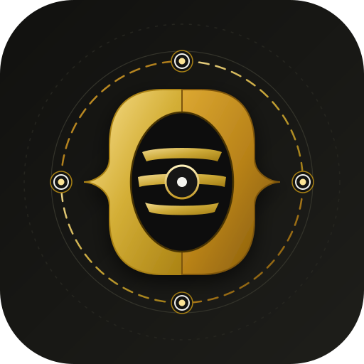

<p align="center">
  
</p>

# umgodi-json

**Umgodi** is RAIkeep's actively developed Python library for distributed JSON
storage with immutable history across synchronized cloud drives. Install the
`umgodi-json` package, import `umgodi`, and use the continuing `jpit` command
to seed, export, inspect, and maintain synchronized data.

## Why `umgodi-json`?

`umgodi-json` is the current Python project. It replaces the historical
`jsonpit-python` project and its `jsonpit` distribution, which are now frozen.
The implementation continues the same storage contract under a new name so
the Python identity is clear and distinct from the C# project that originated
the design.

The `jpit` CLI remains an actively developed command-line interface. Install
the new distribution with `pip install umgodi-json`; existing `jsonpit` 4.6.3
installations remain available as the frozen predecessor.

Umgodi inherits its design and storage compatibility from the C# `JsonPit`
project, available on [GitHub](https://github.com/Burkhardt/JsonPit) and
[NuGet](https://www.nuget.org/packages/JsonPit/). `JsonPit` is the heritage
and cross-engine reference; **Umgodi is the Python library you install and
use**. The C# and Python lines are intended to evolve in sync for the
foreseeable future.

The Python names are intentionally distinct: `inqaba` is the maintained
RaiKeep Python framework used heavily by Umgodi for paths, files, configuration,
and related boundaries; `vikela` is the companion Python linter that provides
guardrails for using those opinionated framework APIs safely. Both projects
are recommended for application and agent code built on Umgodi.

The Zulu names express the Python line's connection to Ubuntu—both as an idea
of shared human infrastructure and as a target operating-system family. The
packages are not Linux-only: we test on macOS and Windows as well as Linux
distributions. The complete test suite includes unit, cross-engine, and
selected remote-over-SSH scenarios, providing practical confidence in the
storage and synchronization behavior.

JsonPit change requests and release notes are centralized in the RAIkeep [`doc/`](https://github.com/Burkhardt/RAIkeep/tree/main/doc) directory under `JsonPit_...` filenames; they are not stored separately in this child repository.

JsonPit stores JSON documents with value history across processes, machines, and servers using [asynchronous persistence with eventual durability](https://github.com/Burkhardt/RAIkeep/blob/main/MANIFESTO.md#asynchronous-persistence-with-eventual-durability).

**CLI tools:** use `pits` (see [PitSeeder](https://github.com/Burkhardt/PitSeeder)) or [`jpit`](https://pypi.org/project/umgodi-json/) to seed, export, inspect, and maintain JsonPits. Use [`amafu init`](https://github.com/Burkhardt/Amafu) to detect cloud drives and create the shared RAIkeep configuration.

The canonical **reference (lead) implementation** is C# `JsonPit` and the `pits` CLI in [RAIkeep](https://github.com/Burkhardt/RAIkeep). `umgodi` is the pure-Python implementation engineered for 100% behavioral and physical storage parity with zero deviation.

---

Seeding merges supplied properties and preserves omitted ones. Use `del-prop` (`delete-property`) to remove a property or `del` (`delete-item`) to remove the whole item.

## CR081 seed disposition receipt

Seed receipts count source entries, including repeated IDs, using the engine's
accepted-fragment result:

```text
[jpit] 3 source items: 1 written, 2 unchanged (Pit 'Object').
[jpit] 3 source items: 0 written, 3 unchanged (Pit 'Object').
```

A no-op exits 0. `--debug` / `-b` lists unchanged IDs on stderr. “Written” means
newly accepted source fragments whose required local persistence completed;
it is neither a physical file-write count nor confirmation of cloud replication.
The success line follows Save and required disposal/process-window cleanup.
Persistence failures return nonzero without that receipt. `--window` retains its
existing explicit opt-out from window release; Save must still succeed.

All source entries and strict `-x` / `--id-exists` / `--patch` targets are validated
before mutation. Equality is against the latest fragment ignoring Modified,
not against the projected state. A sparse patch matching projected values may
therefore still append a fragment; distributed ordering and tombstones are preserved.


## Latest Version 4.7.3

The active Python distributed-persistence implementation is now distributed as
`umgodi-json`. It uses Inqaba for paths, files, and shared configuration; its
JsonPit-compatible heritage is described above rather than hidden behind the
old project name.

Without `-c`, `jpit export Object -r AfricaStage --out-dir ./exports` resolves
the bare tenant name beneath the configured default cloud, matching `history`.
Use `-c <provider>` to select a cloud explicitly, or `-r ./AfricaStage` / an
absolute path for local storage. A same-named local directory does not override
a bare tenant name. This also applies to report-only WWWA maintenance, audit,
and grep's default target with `-r`.

Export exits `1` with the missing canonical `.pit` path on stderr when a source
snapshot is absent. It emits no JSON or success receipt and leaves existing
export files intact. `--wwwa` requires all four snapshots; a valid existing
empty snapshot still exports `[]` successfully.

Latest release notes: [coordinated RAIkeep release notes](https://github.com/Burkhardt/RAIkeep/blob/main/doc/releases/v4.x/umgodi-json_RELEASE_NOTES_4.x.md#473).

## Previous Versions

See the [umgodi-json 4.x release notes](https://github.com/Burkhardt/RAIkeep/blob/main/doc/releases/v4.x/umgodi-json_RELEASE_NOTES_4.x.md).

## Key Features

- **The Persistence Fabric for AI Agents:** Autonomous agents running across macOS desktop apps, backend servers, and web runtimes synchronize memory and living state across shared cloud drives without managing database servers, connection pools, or cloud credentials.
- **0% Deviation from C# JsonPit:** Reads, merges, and writes pits with identical canonical JSON serialization, UTC timestamp precision, and tombstone semantics.
- **Filesystem and configuration:** Umgodi uses the Inqaba framework.
- **Cloud-Safe Filesystem Invariants (CR022):** In-place sibling writes (`.pit.tmp` $\rightarrow$ atomic rename within the same cloud volume). Prevents cross-device link errors (`EXDEV`) and OneDrive mass-deletion alarms.
- **Full Distributed Lease Protocol:** Implements master writer leases (`Master.flag`) and PID-specific process activity windows (`{Machine}-{Process}-{PID}.flag`) with automatic process naming from `sys.argv[0]`.
- **Ecosystem Configuration:** Seamlessly reads machine cloud paths from `~/.config/RAIkeep.json5` (with `~/.config/umgodi.json5` fallback).
- **Pure Object-Oriented Design:** Rich domain entities (`Pit`, `PitItem`, `PitItems`) implementing standard Python protocols (`MutableMapping`, `ContextManager`).

---

## Object-Oriented Architecture

`umgodi` models distributed state through rich, encapsulated domain classes implementing standard Python protocols (`MutableMapping`, `ContextManager`):

- **`Pit`**: Living collection and coordinator of distributed leases, change files, and storage compaction.
- **`PitItem`**: Polymorphic living entity. Emits pure sparse deltas without read-modify-write cycles (CR040).
- **`PitItems`**: Immutable fragment stack managing value history and accurate point-in-time state projection.
- **`JsonPitBase`**: Shared foundation for storage resolution, subscriber roles, and cloud synchronization.
- **`PitMaintenanceOptions` / `PitMaintenanceResult`**: Automated reconciliation, 10-minute receipt grace periods, and flag pruning (CR021/CR022).
- **`PitAudit` / `PitAuditEvent`**: Read-only durable recovery event inspection without acquiring leases or flags (CR003).

See the [class diagram](https://raw.githubusercontent.com/Burkhardt/umgodi-json/main/doc/umgodi-class-diagram.svg), its [PlantUML source](https://github.com/Burkhardt/umgodi-json/blob/main/doc/umgodi-class-diagram.puml), the [getting started guide](https://github.com/Burkhardt/umgodi-json/blob/main/GettingStarted.md) and the [API reference](https://github.com/Burkhardt/umgodi-json/blob/main/API.md).

## Installation & Upgrade

Python 3.12 or newer is required.

### CLI with pipx

Install one environment for both commands:

```bash
pipx install "umgodi-json==4.7.3"
jpit --version
umgodi --version
```

To upgrade:

```bash
pipx upgrade umgodi-json
```

The expected outputs are `jpit v4.7.3` and `umgodi v4.7.3`. Both commands come from the same distribution.

On Ubuntu/Debian, install pipx with `sudo apt install pipx` if needed. On macOS,
use `brew install pipx`. Run `pipx ensurepath` and start a new shell if the commands
are not on PATH. System Python may reject direct pip installation with
`externally-managed-environment`; use pipx for the CLI.

### Library in a virtual environment

```bash
python3 -m venv .venv
source .venv/bin/activate
python -m pip install "umgodi-json==4.7.3"
```

Use `import umgodi` in Python. Existing `jsonpit` environments can continue using the frozen 4.6.3 release.

---

## Quickstart

### 1. Cloud-First Triad (The Standard Pattern)

Given a machine configured with `~/.config/RAIkeep.json5`:

```python
from umgodi import Pit, PitItem

# Automatically resolves cloud storage (OneDriveData/AfricaStage/Person/):
with Pit.open("Person", cloud="OneDrive", root="AfricaStage") as pit:
    # Get an entity (projected state)
    sipho = pit.get("Sipho")
    if sipho:
        print(f"Sipho's current role: {sipho.get('Role')}")
        # Mutate an entity: sparse append-only mutation, auto-sets Deleted=False
        sipho.set_property({"Status": "Active", "Location": "RehearsalStage"})

    # Add a new entity
    hugh = PitItem(id="HughMasekela")
    hugh.set_property({"Genre": "Jazz", "Instruments": ["Flugelhorn", "Cornet"]})
    pit.add(hugh)

# On exit of the context manager:
# 1. Point-in-time snapshot captured
# 2. In-place sibling temporary file written (CR022 cloud-safe)
# 3. Atomically replaces Person.pit on the cloud volume
# 4. Owned process activity flag cleanly released
```

### 2. Local / Explicit Filesystem Path

For an explicit Pit directory, pass an Inqaba `InqPath` (not a `pathlib.Path`
or a `.pit` filename). Test Pits must be on the configured Dropbox drive.
Dropbox Pits read `Dropbox/JsonPit/timing.json5`; if it is missing, Umgodi reads
the original `OneDrive/JsonPit/timing.json5`. Test setup copies the unchanged
OneDrive file into Dropbox once when needed, without overwriting an existing
file, and warns that Dropbox-specific timing should be calibrated.

```python
from inqaba import InqPath

with Pit.open(InqPath("/path/to/my/Person")) as pit:
    for item in pit.values():
        print(item.id, item.modified)
```

### 3. Developer Companion CLI: `jpit`

The package installs both `jpit` and `umgodi` commands:

```bash
# Fast semantic search across one or all pits ("Pit-Grep"):
jpit grep "Adele" Person
jpit grep "Burkhardt" --root AIA

# Pipe search results directly into jq:
jpit grep "Jazz" Person --json | jq '.[].Genre'

# Inspect current state and fragment history:
jpit export Person -r ./AfricaStage --json | jq '.[] | select(.Id == "Rainer")'
jpit history Person Rainer -r ./AfricaStage

# Add sparse fragments from a file or stdin. Existing attributes survive omission.
jpit seed Person -r ./AfricaStage --source update.json5
echo '{Id: "AlanKay", Status: "Visionary"}' | jpit add Person -r ./AfricaStage --source - --patch
jpit delete-item Person ObsoleteEntity -r ./AfricaStage

# Automated maintenance and dead flag pruning (100% C# pits maintain parity):
jpit maintain Activity -c OneDrive -r AIA
jpit maintain Activity -c OneDrive -r AIA --apply --prune-process-flags --older-than 01:00:00 --json
jpit maintain --wwwa -c OneDrive -r AIA --apply --prune-process-flags --older-than 7.00:00:00

# Read-only audit of durable recovery events (100% C# pits audit parity):
jpit audit Activity -c OneDrive -r AIA
jpit audit Activity -c OneDrive -r AIA --machine local --level Warning
jpit audit --wwwa -c OneDrive -r AIA --json
```

---

## The Physical Structure of a Pit

A Pit is not a single file—it is a **Directory Ecosystem**:

```
Person/
├── Person.pit                     # Canonical point-in-time snapshot
├── Master.flag                    # Master writer lease ticket (Owner|Timestamp)
├── Nkosikazi-python-59346.flag    # Process activity window ({Machine}-{App}-{PID}.flag)
├── Events/                        # Immutable change streams & compaction archives
└── Changes/                       # Hashed, collision-safe change files & receipts
```

---

## Autonomous Agents & Cross-Platform State

`umgodi` solves the distributed state dilemma for autonomous AI agents:

1. **Zero Database Infrastructure:** An agent needs only a directory path on a synchronized cloud drive (e.g. `OneDriveData/AIA/AgentMemory`). It never requires cloud database API keys, connection pools, firewall punch-through, or hosted database servers.
2. **Auditability & Time-Travel:** Because history is strictly append-only and stamped with .NET `UtcTicks`, every agent mutation retains full provenance. Operators or supervising agents can time-travel and inspect exact state at any millisecond.
3. **Multi-Agent Collision-Proof Coordination:** Multiple agents (or desktop apps + background agents) coordinate through collision-free change files (`Changes/`) and opportunistic master writer leases (`Master.flag`), guaranteeing eventual consistency without write collisions.

---

## Development & Testing

### Cross-Library Differential Parity Battery

To ensure 100% interoperability with C# `JsonPit`, this repository includes a dedicated **Differential Cross-Testing Suite** (`tests/suites/*.json5` & `tests/sequence_runner.py`). The test harness orchestrates bidirectional interaction between the Python runtime (`jpit`) and the C# CLI binary (`pits`):

- **Python Writes $\rightarrow$ C# Validates:** Python writes `.pit` snapshots and sparse changes; C# `pits export` and `pits verify` assert physical byte formatting, timestamp precision, and schema invariants.
- **C# Writes $\rightarrow$ Python Validates:** C# `pits seed`, `delete-property`, and `maintain` mutate state; Python `jpit export`, `history`, and `PitStore` verify projections and receipt mechanics.
- **7 Parity Suites (41 Cross-Engine Steps):** Covers persistence CRUD, CR041 clean change files, receipt grace periods, nested property tombstones, compaction/events archiving, process flag lifecycles, and split-master partition recovery.

For full suite descriptions, architecture diagrams, and certification tables, see:  
👉 **[`doc/CROSS_ENGINE_PARITY_SPECIFICATION.md`](https://github.com/Burkhardt/umgodi-json/blob/main/doc/CROSS_ENGINE_PARITY_SPECIFICATION.md)**

```bash
# Run the full test battery (Unit Tests + 7 Cross-Engine Parity Suites):
python3 tests/run_all.py

# Run a specific declarative parity suite directly:
python3 -m tests.sequence_runner tests/suites/01_persistence_and_crud.json5
```
